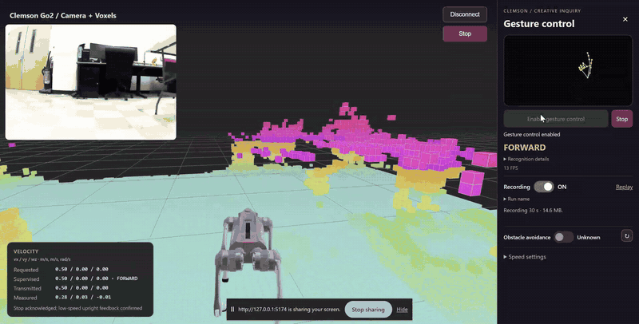
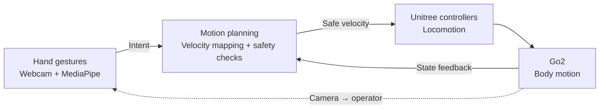

# Go2 Gesture Navigation

**A weekend robotics project: steer a Unitree Go2 with your hand and see what it sees.**

Use your Windows webcam to recognize hand gestures, request supervised walking,
and watch the Go2 camera and voxel view in one dashboard. Record a short run,
replay it offline, then try your own gesture rules.

**Windows 11 + Python + Chrome. No ROS, WSL, Docker, or external Jetson required.**
WebRTC connects the laptop to the robot over Wi-Fi; it is built into the setup.
This repo contains the gesture application, not a ROS workspace.



[Setup help](docs/DEPENDENCIES.md) · [Screen guide](docs/STUDENT_ORIENTATION.md) ·
[Your own gestures](docs/STUDENT_INTEGRATION.md) · [Record/replay](docs/RECORDING.md)

## What you will build



The webcam sees your hand; the robot camera sees the operating area. Unitree's
existing controller handles walking. The app bounds commands and rejects stale
input; it does not implement collision-free planning. Voxels help the operator.

## Before you start

- Windows 11 x64, Git for Windows, Miniconda/Anaconda, Chrome, and a webcam.
- Authorized Go2 access, private Wi-Fi password/AES key, and the paired remote.
- A clear, level test area and an experienced supervisor for physical trials.

Install while you have internet access. The robot hotspot may not provide it.
Keep credentials and full recordings outside Git. This interface takes body-motion
requests, not Go1 simulation joint targets or a trained locomotion policy.

## 1. Install once

In **Anaconda / Miniconda Prompt**:

```bat
git clone https://github.com/sriram-2502/go2-gesture-nav.git
cd go2-gesture-nav
conda create -n go2wifi python=3.11 pip -y
conda activate go2wifi
python -m pip install -r requirements.txt
python -m gesture_preview.download_model
python -m pip check
```

Activate an existing `go2wifi` environment instead of recreating it.
Then, in **PowerShell from the same repo folder**:

```powershell
powershell.exe -NoProfile -ExecutionPolicy Bypass -File .\setup-ui.ps1
```

Setup downloads a checksum-verified local Node runtime and the pinned upstream
UI, then applies this dashboard. No system Node installation or separate Basic
UI repo is needed. See [dependency help](docs/DEPENDENCIES.md).

## 2. Start two terminals

Keep both terminals open, with this repo as the working directory.

**Terminal 1 — Anaconda / Miniconda Prompt:**

```bat
conda activate go2wifi
python -m gesture_preview.server
```

**Terminal 2 — PowerShell:**

```powershell
powershell.exe -NoProfile -ExecutionPolicy Bypass -File .\start-ui.ps1
```

Open **http://127.0.0.1:5174/** in Chrome. The gesture service uses **8766**;
the browser reaches it through the dashboard. The default is the Clemson
gesture UI, including battery, Jump once, Bound gait, recording, and replay.

## 3. Preview, connect, then walk

1. Leave control disabled. Check that the skeleton and gesture label follow your hand; close other webcam apps.
2. Complete the normal Go2/remote checks with the supervisor. Join the **Go2 hotspot**, not campus Wi-Fi. Default robot address: **192.168.12.1**.
3. Close the phone app and other robot clients. Enter the private AES key locally and choose **Connect and open web view**.
4. Confirm fresh camera/state. Match **Navigation | UI build ID** to the launcher.
5. Click **Enable gesture control** directly; no palm/fist startup ritual. Motion waits for fresh post-enable frames and a consistent gesture.
6. Try one brief motion at a time. Use a stop pose or **Stop** and verify physical stopping. Finish with **Disconnect**, then Ctrl+C in both terminals.

Obstacle avoidance has separate readback; visible voxels do not prove protection.
For unconfirmed recovery, use the paired remote and [the screen/recovery guide](docs/STUDENT_ORIENTATION.md).

## Your first gestures

Match the direction in the **mirrored hand panel**. One gesture controls one axis.

| Hand pose | Default request |
| --- | --- |
| Index up, other fingers curled, palm toward webcam | Forward, 0.5 m/s |
| Index pointing left | Sideways left, 0.5 m/s |
| Index + middle fingers pointing left | Sideways right, 0.5 m/s |
| Thumb up | Turn left, 0.8 rad/s |
| Thumb down | Turn right, 0.8 rad/s |
| Open palm, fist, missing hand, or unclear pose | Stop request |

Hold movement for **300 ms**; input older than **400 ms** is rejected.
A sent stop request is not proof of a physical stop. See the
[illustrated guide](dashboard/README.md#gesture-guide-what-your-hand-commands).

## Optional: Jump once and Bound gait

These buttons sit below the battery, use the same connection, and pause gesture
navigation when selected. They are not default hand gestures.

- **Jump once:** one forward-jump request; repeat actions stay locked until Stop/recovery is confirmed.
- **Bound gait:** waits for a successful reply and new mode feedback; explicitly enable gestures afterward. Stop requests exit.

Ordinary walking is the baseline. Optional behaviors need separate instructor
approval and robot/firmware checks. A reported successful jump does not qualify
all recovery cases. Read [behavior and recovery](dashboard/CONTROL_EXTENSIONS.md)
before trying either. Stationary Look Around remains disabled.

## Record, replay, customize

Turn **Recording ON** before enabling gestures and choose the dashboard tab in
Chrome. Turn it OFF to save videos and available telemetry in one local ZIP.
**Replay** opens it offline without sending robot commands. See [the recording guide](docs/RECORDING.md).

Start experimenting without a robot:

```bat
python -m examples.gesture_mapping
python -m gesture_navigation --demo
```

Edit `gesture_preview/gestures.py` and `gesture_preview/velocity.py` using the
[integration guide](docs/STUDENT_INTEGRATION.md). Retain supervision, timestamps,
limits, and robot checks.

## Project layout

```text
setup-ui.ps1 / start-ui.ps1   Install and launch
requirements.txt             One Python dependency list
gesture_preview/             Webcam, gesture rules, supervision
dashboard/overlay/           Tracked UI and robot adapter
dashboard/tests/             Offline browser-side checks
examples/                    Robot-free examples
docs/                        Setup help, recording, research roadmap
```

Generated `dashboard/unitree_ui/`, `upstream/unitree_ui/`, and `.tools/` are
ignored. Edit tracked overlays; startup reapplies them. See [contributing](CONTRIBUTING.md).

## Update and restart

Disconnect and stop both services. In PowerShell from this repo:

```powershell
git status
git pull --ff-only
powershell.exe -NoProfile -ExecutionPolicy Bypass -File .\setup-ui.ps1
```

Restart both terminals, hard-refresh Chrome with Ctrl+Shift+R, and match the build
ID. Preserve local edits if Git refuses the update.

**Old checkout?** The `webrtc/` wrapper and legacy `ros/` files were removed.
Use the root commands above and reuse your `go2wifi` environment. Rerun setup
to create the new generated dashboard location. Old generated checkouts are not
used. Recordings remain compatible and stay local.

## Future projects and the CI course

Build from kinematics/dynamics and logging toward localization, elevation mapping,
motion planning, and multiagent navigation. These are proposed extensions; RL
locomotion training is beyond the initial undergraduate scope. See [the roadmap](docs/ROADMAP.md).

For Clemson Creative Inquiry, use **this setup for Weeks 7 onward**: stationary
inspection first, then supervised gestures, recording, and optional behavior
experiments. [The course website](https://dyco-ai.github.io/go1_gesture_tracking/)
sets expectations. [The Go1 simulation and weekly labs](https://github.com/sriram-2502/go1-mujoco-playground)
remain a separate teaching checkout; reports follow the course policy.

Developed by [Sriram Krishnamoorthy](https://github.com/sriram-2502).
Original code/docs: [MIT](LICENSE). [Third-party notices](NOTICE.md) · [Demo provenance](docs/DEMO.md).
