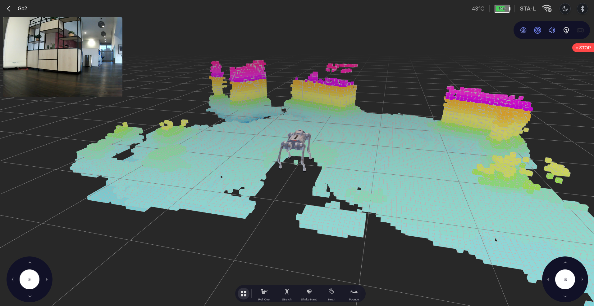

# Go2 WebRTC Gesture Navigation

**Clemson Creative Inquiry · Windows 11 · MediaPipe · Unitree Go2**

Steer a Go2 using hand gestures while watching its onboard camera and voxel view.
This instructor setup brings together the Unitree web interface, extracted hand
landmarks, supervised velocity requests, and recording/replay. Students can bring
their gesture recognition work from the earlier simulation labs.

[Get started](#clone-this-setup-from-github) · [Clemson dashboard](webrtc/clemson/README.md) ·
[Bring your gestures](webrtc/STUDENT_INTEGRATION.md) · [Recording & replay](webrtc/RECORDING.md)



*Go2 camera, robot model, and voxel view in the upstream Basic interface.
Screenshot from [legion1581/unitree_ui](https://github.com/legion1581/unitree_ui),
used with its [MIT notice](webrtc/clemson/UPSTREAM_LICENSE). This is an upstream
reference image; our Clemson dashboard capture and motion GIFs are on the
[media TODO](docs/ROADMAP.md#readme-images-and-motion-gifs).*

## What students build

```text
Windows webcam → MediaPipe landmarks → your gesture classifier
                                                ↓
                                 bounded velocity + supervision
                                                ↓
Go2 camera + voxels ← Clemson browser UI ← Wi-Fi / WebRTC → Go2
```

| In the dashboard | What it does |
| --- | --- |
| Robot view | Onboard camera and available voxel stream in the main window |
| Hand panel | Extracted MediaPipe skeletons and gesture labels; webcam pixels stay local |
| Velocity overlay | Requested, supervised, transmitted, and measured motion |
| Explicit control | Enable/Stop controls, freshness checks, and bounded commands |
| Experiment tools | Obstacle-avoidance switch, one recording toggle, and offline replay |

The Windows webcam sees the student's hand. The Go2 camera sees the maze.
For the CI activity, students navigate using the robot view while an instructor
maintains direct sight and the paired remote.

## Gesture starter

<p align="center">
  
</p>

*Programmed starter gestures, illustrated with hand landmarks. These diagrams
explain the mapping; they are not measurements of recognition accuracy.*

Start with the [illustrated gesture table](webrtc/clemson/README.md#gesture-guide-what-your-hand-commands),
or [adapt your own earlier classifier](webrtc/STUDENT_INTEGRATION.md) while retaining
the instructor's command limits and stop checks.

## Choose your setup

The CI course uses the **WebRTC + Wi-Fi** path on Windows 11. The separate
ROS/Ethernet guide is available for research students.

| Path | Intended audience | Connection and execution | What it supports |
| --- | --- | --- | --- |
| [ROS 2 + Ethernet](ros/README.md) | Research and PhD students | Laptop connects by Ethernet; SSH into the Go2's onboard Jetson; run Python on the Jetson | Bounded velocity commands and optional ROS 2 bag recording |
| [WebRTC + Wi-Fi](webrtc/README.md) | Creative Inquiry and undergraduate students at Clemson | Laptop joins the Go2 Wi-Fi hotspot; run Python locally on the laptop | Connection test and bounded velocity commands, without a laptop ROS installation |

The two paths use different robot interfaces. The Jetson's Ethernet address in
this lab is `192.168.123.18`; the WebRTC hotspot endpoint is `192.168.12.1`.
The WebRTC path requires a private, robot-specific AES key supplied by the lab.

## Clone this setup from GitHub

For the CI course, keep this hardware checkout separate from
`go1-mujoco-playground`. Install Git for Windows first. In **PowerShell**:

```powershell
Set-Location "$env:USERPROFILE\Downloads"
git clone https://github.com/sriram-2502/go2-webrtc-gesture-nav.git go2-webrtc-gesture-nav
Set-Location .\go2-webrtc-gesture-nav
git rev-parse --short HEAD
```

If this folder already exists, use that checkout rather than cloning over it.
See [WebRTC dependencies](webrtc/DEPENDENCIES.md) for the `go2wifi` environment,
then [Basic dashboard setup](webrtc/UI_SETUP.md) and [Clemson gestures](webrtc/clemson/README.md).
The setup script downloads the pinned upstream UI and local Node runtime;
downloaded dependencies, model weights, keys, and recordings are not in Git.

## Get instructor updates

Stop the UI and webcam service with Ctrl+C and disconnect the robot first.
With internet access, from this hardware checkout:

```powershell
git status
git pull --ff-only
git rev-parse --short HEAD
powershell.exe -NoProfile -ExecutionPolicy Bypass -File .\webrtc\setup-ui.ps1 -Edition all
```

Preserve local changes before pulling. If Git refuses the update, ask the
instructor instead of resetting or force-pulling. Follow any changed Python/model
installation steps in [DEPENDENCIES.md](webrtc/DEPENDENCIES.md). Record the commit
in your weekly report. This setup checkout is for instructor updates; student
reports belong on the team branch of the playground repository.

Then join the assigned **Go2 Wi-Fi hotspot**, rather than Clemson campus Wi-Fi,
and connect to **192.168.12.1**. Ask the instructor for the private AES key and
Wi-Fi password. The robot hotspot may have no internet; install/update before
switching networks. No credentials are included in this repository.

## Repository layout

```text
ros/                    Jetson ROS 2 script, setup guide, controller photo
webrtc/                 Laptop WebRTC scripts and setup guide
docs/                   Credential access and project roadmap
archived/               Original ZIP downloads (local only; ignored by Git)
private/                Lab credentials and private notes (local only; ignored)
```

Start with [ROS instructions](ros/README.md) or [WebRTC instructions](webrtc/README.md).
Use the checked-out source files; the original ZIP downloads are archival copies.
Recordings belong outside version control, such as `~/go2_data` on the Jetson.

## Before commanding motion

Use the lab's supervised operating procedure. Confirm normal standing and remote
control first, clear the travel area, and keep the paired remote ready. Run one
motion controller at a time. Software stop commands depend on a working connection;
visually confirm the robot has stopped before starting another run.

## Current status

- **ROS:** the existing guide records walking and stance tests on the lab robot.
  Recording lifecycle checks used simulated interfaces; actual bag capture still
  needs verification on the Jetson.
- **WebRTC:** the existing notes record successful AES-key retrieval on Windows 11
  with Go2 software v1.1.15. The scripts are included; connection and motion tests
  are not yet documented as verified.
- **Dashboard:** [Windows launch options](webrtc/UI_SETUP.md) now include pinned
  upstream `unitree_ui` and a separate Clemson branded starter. Basic source builds
  and the local server were checked; robot video, voxels, SLAM, and motion still
  need verification. Clemson now adds a webcam/MediaPipe preview using `go2wifi`;
  explicitly enabled gesture navigation is implemented with offline checks;
  recording and offline replay are also implemented. Physical operation and
  browser screen-capture verification remain outstanding.

See the [roadmap](docs/ROADMAP.md) and [private-key access plan](docs/KEY_ACCESS.md).
Never include a robot key, password, cloud token, or private configuration in a
public issue, screenshot, commit, or dashboard bundle.

## Contributing and public release

See [CONTRIBUTING.md](CONTRIBUTING.md) for documentation and verification expectations.
A project-wide license has not been selected. Existing third-party license
notices remain in effect; see [NOTICE.md](NOTICE.md). Publication does not grant
additional rights to third-party software or media.

## Course and instructor reference status

This [GitHub setup repository](https://github.com/sriram-2502/go2-webrtc-gesture-nav) is the current CI hardware
reference. Students clone it separately from the playground. A later repository
split remains optional future work; no laptop-local bundle is required.

- [Course website](https://dyco-ai.github.io/go1_gesture_tracking/): schedule and assignment expectations; the course retains its Go1 name.
- [Student code and weekly labs](https://github.com/sriram-2502/go1-mujoco-playground): Go1 simulation followed by Go2 hardware onboarding.
- [Submission/data policy](https://github.com/sriram-2502/go1-mujoco-playground/blob/main/course/SUBMISSIONS.md): individual weekly README reports on team branches, optional small media, full data stored locally, and a final Markdown report.

This hardware version uses Go2 WebRTC on Windows 11. Physical Go1 integration is
under development. Ask the instructor for the AES key and Wi-Fi credentials;
never place them in reports or Git. Install dependencies using internet first,
then join the assigned **Go2 hotspot** at **192.168.12.1** for robot access.
Do not use Clemson campus Wi-Fi for this connection; firewall/client isolation
can interfere. Do not disable security controls to work around connection issues.

Full run ZIPs, telemetry, and videos belong in local experiment storage with a
backup. Export only selected small, sanitized evidence into student submissions.

## Reuse your earlier gesture work

Students can adapt their MediaPipe/gesture functions from earlier CI weeks into
this instructor application. Follow [the student integration guide](webrtc/STUDENT_INTEGRATION.md)
for the exact Python integration point and label mapping; retain the supplied
command supervision and WebRTC adapter. The ROS guide remains a separate option.

The maintainer's existing checkout folder may keep its old name. New student
clones use `go2-webrtc-gesture-nav`; no local-folder rename is required.
