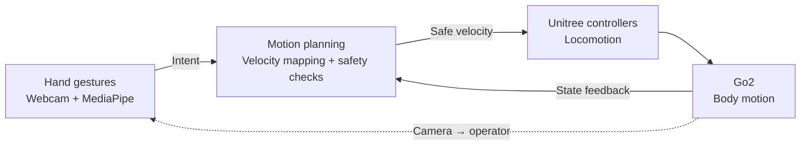
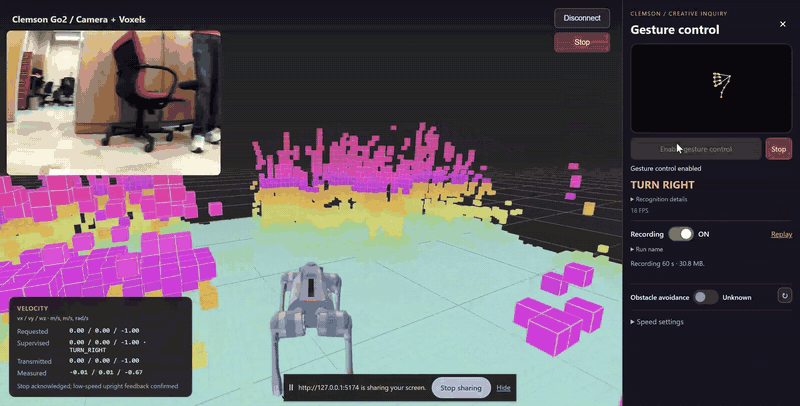
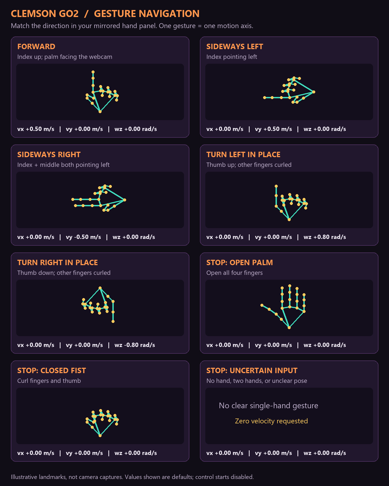

# Go2 Gesture Navigation

**Windows 11 · Python · MediaPipe · Unitree Go2 · No ROS required**

Navigate a Go2 with hand gestures while watching its onboard camera and voxel
view. This project combines a focused Unitree UI dashboard, extracted hand
landmarks, supervised velocity commands, and local recording/replay. The Windows
webcam observes your hand; the robot camera shows where the robot is going.

[System design](#system-design) · [Quick start](#quick-start-on-windows-11) ·
[Gesture guide](#default-gestures) · [Repository layout](#repository-layout) ·
[Dashboard guide](webrtc/clemson/README.md) · [Record and replay](webrtc/RECORDING.md) ·
[Customize your gestures](webrtc/STUDENT_INTEGRATION.md) · [Future projects](#future-projects)


[Watch the higher-quality silent MP4](https://github.com/sriram-2502/go2-gesture-nav/releases/download/v0.1.0/go2-gesture-dashboard-demo.mp4) ·
[View the dashboard still](docs/assets/go2-gesture-dashboard.png)

## What you can build

- **Gesture navigation:** use simple Python rules to turn hand landmarks into forward, sideways, and turn-in-place requests.
- **A focused robot dashboard:** camera and available voxels in the main view; extracted hands and controls in a compact side panel. Full webcam pixels are not displayed or sent to the browser.
- **Feedback-driven experiments:** compare requested, supervised, transmitted, and measured velocities in the main-view overlay.
- **Local recording and review:** one recording toggle saves dashboard/video and structured data; a separate replay page opens saved runs without connecting to the robot.
- **Your own classifier:** bring gesture logic from simulation or another project while retaining the command supervisor and robot adapter.

This is high-level navigation through the Go2's existing walking controller.
It does not replace locomotion control, deploy an RL policy, or implement
joint/torque-level MPC. Mapping and voxel availability depend on robot firmware.

## Current dashboard controls

| Location | Available controls / feedback |
| --- | --- |
| Camera/voxel view, top right | Disconnect, Stop, robot battery graphic and percentage, Jump once, and Bound gait |
| Hand sidebar | Extracted landmarks, recognition hints, Enable gesture control / Stop, recording, obstacle-avoidance readback, and speed settings |
| Camera/voxel view, bottom left | Requested, supervised, transmitted, and measured velocity; stop/recovery results |

**Enable gesture control** is a direct button action; no palm/fist startup pose
is required. Fresh hand-tracking frames, robot state, and video are still needed.
Movement waits for fresh post-enable frames and the gesture consistency hold.

**Jump once** pauses gesture navigation and requests one forward jump. **Bound
gait** selects a gait, then requires explicit gesture enabling for navigation.
These are Unitree's onboard behaviors. Availability and recovery depend on the
assigned firmware; a successful request is not proof of completed motion.
See [behavior controls and recovery](webrtc/clemson/CONTROL_EXTENSIONS.md).

**Stationary Look Around is removed and disabled in production.** Its firmware
and mode-transition investigation is on the [roadmap TODO](docs/ROADMAP.md#optional-application-improvements).
The recorded demos above predate the new battery and behavior controls.

## System design

The system closes the loop from **human intent → supervised body velocity →
robot locomotion → robot feedback**. The laptop handles gesture perception and
high-level motion commands; Unitree's onboard controllers handle walking.



*Gesture intent becomes a supervised body velocity. Robot state feeds the motion
checks, and the camera view helps the operator choose the next gesture.*

Modeling provides a foundation for understanding these layers: coordinate
frames, leg kinematics, Jacobians, rigid-body dynamics, and ground contacts.
Undergraduate projects can work at the motion-planning interface while using
the existing onboard walking controller. Training RL locomotion policies and
deploying new low-level controllers are advanced extensions beyond the current
undergraduate research scope. See [Future projects](#future-projects).

### Inside the motion block

| Stage | Inputs | Output / decision |
| --- | --- | --- |
| **Map intent** | Recognized gesture and configured forward/turn speeds | Requested body velocity `u_req = (vx, vy, wz)`; one motion axis at a time |
| **Supervise intent** | Gesture label, acquisition timestamp, speed limits, and gesture history | `supervised_velocity`; movement waits for a 300 ms hold, and stale or stop input produces zero |
| **Gate robot commands** | Supervised velocity, label/frame validity, enable state, connection, body height, robot-state age, and camera-frame age | Eligible velocity is routed to `Move`; failed checks disable control and request stopping if moving |
| **Execute locomotion** | High-level velocity or stop request over WebRTC | Unitree's onboard controllers produce the robot's walking motion |

Here **safe velocity** means a bounded command that passed the implemented
supervision and robot checks. This motion block implements gesture-to-velocity
selection and command gating; collision-free trajectory planning is not
implemented. Voxels are displayed for the operator and are not an input to a
local obstacle planner. The robot's obstacle-avoidance setting has separate
readback in the dashboard.

The feedback loop supports command eligibility and stop confirmation. Measured
velocity is displayed and used during stopping; it is not used by a laptop-side
velocity-error controller. Unitree handles locomotion tracking onboard.

### Module rates and timing

These are **configured rates and thresholds from the code**, not measured
end-to-end performance. Camera hardware, inference time, browser scheduling,
Wi-Fi, and robot responses can reduce the achieved rates.

| Module | Configured cadence | Timing / behavior |
| --- | --- | --- |
| [Webcam + MediaPipe + gesture rules](webrtc/gesture_preview/vision.py) | **30 Hz target** (~33 ms/frame) | Capture requests 640 × 480 at 30 FPS; processing is paced to at most 30 fresh frames/s. The panel reports achieved FPS. |
| [Gesture snapshot + Python supervision](webrtc/clemson/overlay/clemson-preview.ts) | **~6.7 Hz nominal** (150 ms polling timer) | Each successful snapshot request runs the [supervisor](webrtc/gesture_preview/server.py). Overlapping polls are skipped; the browser receives the latest extracted landmarks and intent. |
| [Robot command gate / Move dispatch](webrtc/clemson/overlay/gesture-robot.ts) | **20 Hz nominal** (50 ms timer) | Runs while enabled; busy ticks are skipped. Normal-mode Move waits for acknowledgement; MCF Move does not. Dispatch can be slower than 20 Hz. |
| Robot state + camera / voxels | **Stream-driven; rates not measured here** | State and camera frames must each be no older than **1 s** for motion eligibility. Voxel data is for visualization. |
| [Dashboard control / velocity readout](webrtc/clemson/overlay/clemson-preview.ts) | **10 Hz** (100 ms timer) | Refreshes control status and transmitted/measured velocity; hand drawings update with gesture snapshots. |
| Unitree locomotion controllers | **Onboard; internal rates not measured here** | Receive high-level commands; the browser's 20 Hz timer is not the robot's internal control frequency. |

A new motion gesture needs **300 ms of consistent fresh predictions**. Gesture
input expires after **400 ms**, including input age and elapsed time in the
browser; repeatedly reading one frame cannot satisfy the hold. These thresholds
are separate from module frequencies and do not specify physical stop latency.

During stopping, the adapter requests zero velocity and `StopMove`, then looks
for fresh low-speed upright feedback spanning **300 ms** before requesting
`BalanceStand`. The dashboard keeps **requested → supervised → transmitted →
measured** velocity distinct so a sent command can be compared with robot motion.
See the [robot adapter](webrtc/clemson/overlay/gesture-robot.ts) for the full checks.

Python handles webcam extraction and gesture intent. The browser uses one
authenticated robot connection for video, state, and high-level commands.
Preview recognition with motion disabled before enabling the robot adapter.
Dashboard video and structured logs can also be saved as a local recording ZIP
for [offline replay](webrtc/RECORDING.md).

### A second segment



[Watch the second silent MP4](https://github.com/sriram-2502/go2-gesture-nav/releases/download/v0.1.0/go2-gesture-dashboard-demo-02.mp4).

## Default gestures



Match the direction in the **mirrored hand panel**. Velocities use the robot's
body frame: `vx` forward, `vy` left, and `wz` counterclockwise yaw.

| Hand pose | Movement | Default `(vx, vy, wz)` |
| --- | --- | --- |
| Index up, other fingers curled, palm facing webcam | Forward | `(+0.5, 0, 0)` |
| Index pointing left | Sideways left | `(0, +0.5, 0)` |
| Index + middle fingers pointing left | Sideways right | `(0, -0.5, 0)` |
| Thumb up, other fingers curled | Turn left in place | `(0, 0, +0.8)` |
| Thumb down, other fingers curled | Turn right in place | `(0, 0, -0.8)` |
| Open palm, closed fist, missing hand, or unclear pose | Stop request | `(0, 0, 0)` |

Units are **m/s, m/s, rad/s**. Forward speed is adjustable from **0.5–1.0 m/s**;
turn magnitude from **0.5–1.0 rad/s**, default **0.8**. Sideways magnitude stays
fixed at **0.5 m/s**. One gesture commands one axis.

A movement gesture must remain consistent for **300 ms**; input older than
**400 ms** is rejected. Stop/unknown input bypasses the movement hold.
See the [detailed gesture and control guide](webrtc/clemson/README.md#gesture-guide-what-your-hand-commands).

## Quick start on Windows 11

You need Windows 11 x64, Git for Windows, Conda, Chrome, a webcam, and authorized
access to a Go2. Install dependencies while internet is available, before
joining the robot network. ROS, WSL, Docker, and MuJoCo are not needed.

### 1. Clone and install Python dependencies

In **Anaconda / Miniconda Prompt**:

```bat
git clone https://github.com/sriram-2502/go2-gesture-nav.git
cd go2-gesture-nav
conda create -n go2wifi python=3.11 pip -y
conda activate go2wifi
python -m pip install -r webrtc\requirements.txt -r webrtc\requirements-gestures.txt
python -m webrtc.gesture_preview.download_model
python -m pip check
```

If the environment already exists, follow [DEPENDENCIES.md](webrtc/DEPENDENCIES.md)
rather than recreating it. Dependency pins and the tested environment are listed there.

### 2. Prepare the dashboard

In **PowerShell**, from this repository's root:

```powershell
powershell.exe -NoProfile -ExecutionPolicy Bypass -File .\webrtc\setup-ui.ps1 -Edition clemson
```

The setup downloads a local Node runtime and the pinned upstream Unitree UI.
`clemson` is the existing gesture-dashboard edition flag and source folder name;
it is retained for compatibility. The Basic edition is also available; see
[UI_SETUP.md](webrtc/UI_SETUP.md). Read the setup script before running it.

### 3. Start the two local services

**Terminal 1 — Anaconda / Miniconda Prompt**, from the checkout root:

```bat
conda activate go2wifi
python -m webrtc.gesture_preview.server
```

**Terminal 2 — PowerShell**, from the checkout root:

```powershell
powershell.exe -NoProfile -ExecutionPolicy Bypass -File .\webrtc\start-ui.ps1 -Edition clemson
```

Open **http://127.0.0.1:5174/** in Chrome. Test the extracted hand view with robot
control disabled. Close other webcam programs; only one process should own it.
Keep both terminals open. Clemson startup applies tracked UI updates automatically
and prints a build ID, also shown below the camera-view title after connecting.

### 4. Connect to the assigned robot

Join the **Go2 Wi-Fi hotspot** and use robot IP **`192.168.12.1`**. Obtain the
Wi-Fi password and robot-specific AES key privately from the owner/instructor.
Enter the key locally and choose **Connect and open web view**. Campus Wi-Fi is
not this direct robot connection; the hotspot may not provide internet.

Complete the [operator walkthrough](webrtc/gesture_preview/README.md) before
enabling gesture control. Confirm normal standing, fresh robot feedback and
video, clear space, and access to the paired remote. Run one robot controller
at a time. A transmitted stop request is not proof of a physical stop.

The dashboard has an obstacle-avoidance switch with readback. An `Unknown` value
is not an enabled state; confirm the reported setting on your robot. Do
not infer obstacle protection from the visible voxels.

### 5. Enable and finish a session

Click **Enable gesture control**, then use the [default gestures](#default-gestures).
Check the displayed reason if enabling is blocked; do not change speeds to force
motion. Use **Stop** to end control and verify the robot has stopped. If recovery
cannot be confirmed, restore normal standing with the paired remote before using
the dashboard's explicit remote-recovery acknowledgement.

When finished, choose **Disconnect**, then press **Ctrl+C** in both terminals.
See the [student orientation](webrtc/STUDENT_ORIENTATION.md) for screen messages.

## Update and restart

Disconnect the robot and stop the running UI server with **Ctrl+C** before updating.
From your existing checkout's root in **PowerShell**:

```powershell
git pull --ff-only
powershell.exe -NoProfile -ExecutionPolicy Bypass -File .\webrtc\start-ui.ps1 -Edition clemson
```

Reopen **http://127.0.0.1:5174/** and press **Ctrl+Shift+R**. After connecting, the
**Navigation | UI build ID** should match the ID printed in PowerShell. This
confirms which UI code loaded. Restart the Python terminal too when its code or
dependencies changed; otherwise the existing gesture service can keep running.
Routine UI updates do not require reinstalling the full setup.

The Clemson services are **UI: 5174** and **gesture preview: 8766**. Basic uses
**5173**. Clemson does not need the optional Bluetooth backend on **5051**.

## Repository layout

```text
README.md                     Project overview, system design, and daily startup
webrtc/
  gesture_preview/            Python perception, gesture mapping, and supervisor
  clemson/
    overlay/                  Tracked Clemson UI and robot adapter source
    tests/                    Offline browser-side logic/transport tests
    assets/                   Gesture illustrations and their generator
    CONTROL_EXTENSIONS.md     Current Jump/Bound controls and recovery details
  examples/                   Small examples without a robot connection
  setup-ui.ps1                First-time runtime/UI installation
  start-ui.ps1                Daily launcher; applies Clemson updates on startup
  apply-clemson-overlay.ps1   Rebuilds generated UI source from tracked overlays
  ui-source.json             Pinned upstream revision, Node version, and ports
docs/                        Roadmap, demo provenance, teaching, and access notes
ros/                         Separate SSH/ROS workflow; optional for this app
```

Edit Python in `webrtc/gesture_preview/` and UI code in
`webrtc/clemson/overlay/`. The generated folders
`webrtc/clemson/unitree_ui/`, `webrtc/upstream/unitree_ui/`, and `.tools/` are
ignored local dependencies/builds. Changes made only inside the generated UI
can be overwritten when the launcher reapplies overlays. Preserve local changes
before updating. Keep recordings and credentials outside Git.

| Task | Guide |
| --- | --- |
| First-time dependencies or environment problems | [Dependencies](webrtc/DEPENDENCIES.md) |
| Operate the Clemson dashboard | [Dashboard guide](webrtc/clemson/README.md) |
| Understand the first hardware session | [Student orientation](webrtc/STUDENT_ORIENTATION.md) |
| Replace the gesture classifier | [Integration guide](webrtc/STUDENT_INTEGRATION.md) |
| Use the upstream Basic UI | [Basic/Clemson setup](webrtc/UI_SETUP.md) |
| Run checks or contribute | [Contributing](CONTRIBUTING.md) |
| Track deferred features | [Roadmap](docs/ROADMAP.md) |

## Learn the code without moving a robot

```bat
conda activate go2wifi
python -m webrtc.examples.gesture_mapping
python -m webrtc.gesture_navigation --demo
```

These examples print the velocity mapping and simulated supervised observations;
they do not connect to the robot. Start with the small modules:

| Module | Responsibility |
| --- | --- |
| [vision.py](webrtc/gesture_preview/vision.py) | Webcam capture, MediaPipe landmarks, and acquisition timestamps |
| [gestures.py](webrtc/gesture_preview/gestures.py) | Geometric gesture rules and recognition hints |
| [velocity.py](webrtc/gesture_preview/velocity.py) | Gesture-to-velocity table and speed limits |
| [safety.py](webrtc/gesture_preview/safety.py) | Consistency hold, input freshness, and zero requests |
| [server.py](webrtc/gesture_preview/server.py) | Local landmark/intent service for the browser |
| [gesture-robot.ts](webrtc/clemson/overlay/gesture-robot.ts) | Explicit enable, robot feedback checks, and WebRTC command routing |
| [scene-controls.ts](webrtc/clemson/overlay/scene-controls.ts) | Camera-view battery, Jump/Bound buttons, and recovery status |

Follow [the integration guide](webrtc/STUDENT_INTEGRATION.md) to substitute your
classifier. Keep the existing timestamps, limits, supervisor, and robot checks.
The generated UI checkout is ignored; reproducible UI changes belong in the
tracked overlay/setup sources, not only in generated files.

## Recording and replay

Turn **Recording ON**, approve the dashboard capture in Chrome, then enable
gesture control separately. Turn **Recording OFF** to finalize the local run ZIP.
The **Replay** page opens saved runs offline; it does not replay commands to the
robot. See [RECORDING.md](webrtc/RECORDING.md) for streams, timing, and limits.

Keep complete ZIPs, videos, and telemetry outside Git. Webcam pixels are not part of the landmark service;
robot video and hand landmarks are still experiment data. Clear cached keys from
the local UI on shared computers. See [private access](docs/KEY_ACCESS.md).

## Future projects

The proposed research framework starts with robot modeling, then uses the
motion-planning blocks above the existing locomotion controller. These projects
are future work; the current gesture dashboard remains the starting platform.

| Area | Example project / first milestone |
| --- | --- |
| Kinematics and dynamics | Define body/leg frames, forward and inverse kinematics, Jacobians, floating-base dynamics, and contact assumptions; compare a simulation model with available measurements |
| State logging and ROS integration | Qualify actual camera, LiDAR, IMU, pose, and joint fields/rates; bridge suitable ROS topics to the Windows interface and retain reproducible recordings |
| Localization and SLAM | Evaluate visual odometry, VIO, or LiDAR-based SLAM using calibrated sensors and verified timestamps |
| Elevation mapping and perceptive off-road navigation | Build a local terrain-height map, estimate traversability, and use it to choose body-motion requests |
| Motion planning | Compare A*, Dijkstra, RRT/RRT*, path tracking, and local obstacle avoidance under the same maps and trials |
| Multiagent systems | Study shared localization, density-based coordination, and obstacle avoidance; begin with simulation and then one Go2 with simulated peers |
| Advanced locomotion research | Train RL controllers in simulation and investigate transfer to hardware; beyond the current undergraduate scope and not a prerequisite for planning projects |

A proposed ROS extension would run sensor processing, mapping, and planning on
a compatible Linux host or onboard companion computer, with Windows 11 retaining
the operator dashboard. WebRTC can remain part of the transport architecture,
but arbitrary ROS topics and elevation maps need an explicit bridge into the UI.
Concurrent camera/LiDAR operation, connection ownership, package versions, and
network performance still need qualification on the assigned robot.

Current voxel recordings are processed occupancy data, not raw LiDAR scans.
VIO needs calibrated, suitably timed images and inertial measurements; visible
video and telemetry alone do not establish those requirements. A terrain map
also needs consistent sensor transforms and pose estimates. Planning produces
high-level motion requests here; it does not automatically provide foothold
control or a replacement walking policy.

See the [research milestones and data inventory](docs/ROADMAP.md#future-projects-and-research-milestones)
for prerequisites, evaluation criteria, the current CSV/JSONL coverage, and
candidate packages. The roadmap keeps proposed extensions separate from the
validated gesture-navigation application.

## Status and attribution

Developed by [Sriram Krishnamoorthy](https://github.com/sriram-2502).
This is an integration project with pinned upstream UI sources, not a standalone
replacement for Unitree UI. See [NOTICE.md](NOTICE.md) for retained upstream MIT
and perception Apache 2.0 notices. Original project code and documentation are
released under the [MIT License](LICENSE). Demo provenance and export details
are in [docs/DEMO.md](docs/DEMO.md). See the [roadmap](docs/ROADMAP.md) for planned
work and outstanding checks.

## Clemson Creative Inquiry reference

This project also serves as reference code for the **Clemson Creative Inquiry
course I offered in Fall 2026**, [Mission Control: From Human Gestures to
Intelligent Robot Motion](https://dyco-ai.github.io/go1_gesture_tracking/).
The [companion simulation code and weekly labs](https://github.com/sriram-2502/go1-mujoco-playground)
introduce Python, MediaPipe, and gesture navigation before Go2 hardware work.
Students are encouraged to build their own GitHub projects and bring their
earlier gesture pipelines into this reference setup. Follow the course's
submission policy for official weekly reports; keep full run data local.
See [the teaching vision](docs/TEACHING.md) for the broader approach.
