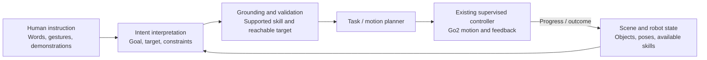

# Go2 gesture-navigation roadmap

This roadmap covers the Windows 11 Go2 gesture-navigation application and proposed
research extensions from robot modeling through motion planning.
Hardware validation of the baseline gesture-navigation setup is complete, as confirmed by the
maintainer.

## Delivered

- [x] Local Windows webcam extraction with MediaPipe and a landmark-only hand panel.
- [x] Readable gesture rules, velocity mapping, consistency hold, and freshness checks.
- [x] Go2 Wi-Fi/WebRTC connection and camera/voxel dashboard based on pinned Unitree UI source.
- [x] Explicit gesture enable, visible stop controls, bounded commands, and robot feedback.
- [x] Requested, supervised, transmitted, and measured velocity overlay.
- [x] Obstacle-avoidance switch with state readback.
- [x] Local recording toggle, structured run data, and offline replay.
- [x] Hardware validation of the existing Go2 gesture-navigation setup.
- [x] Windows dependency and launch instructions, illustrated gestures, and classifier integration guide.
- [x] Two dashboard GIFs, a readable still, and silent demo videos; see [DEMO.md](DEMO.md).
- [x] MIT license for original project code/documentation, with third-party notices retained.

## Documentation and onboarding

- [ ] Have a new user follow the Windows installation and first-session guides and record corrections.
- [ ] Record the supported Go2 firmware and host dependency versions with future releases.
- [ ] Add a short recording/replay walkthrough GIF.
- [ ] Optionally add focused forward/stop, sideways, and turn-in-place demonstration clips. These are presentation improvements, not outstanding baseline hardware validation.

## Private access

- [ ] Migrate Go2 credential distribution to the planned institution-approved Proton Pass arrangement; confirm sharing capacity and maintainer access.
- [ ] Review public Git history and confirm available secret-scanning/push-protection settings.

Keys, passwords, full recordings, and raw experiment data remain outside Git.
Until vault migration, authorized users request credentials privately from the
maintainer. See [KEY_ACCESS.md](KEY_ACCESS.md).

## Optional application improvements

- [ ] Qualify the newly exposed Backflip once control on the assigned robot/firmware, including entry, landing telemetry, Stop/recovery, and remote intervention. The button and clear-area warning have offline tests; this is not a new hardware-validation claim.

- [ ] Revisit stationary gesture-based body pose control. **Deferred and removed from the student UI** after unreliable mode transitions and stop/upright confirmation on the lab robot. Identify the supported firmware/motion service and Pose/BalanceStand/Euler or joystick interface; validate roll/pitch/yaw response, centering, timeout behavior, and return to normal navigation before re-enabling it. Experimental code and offline tests remain, but the production adapter rejects stationary entry.
- [ ] Evaluate maintaining the dashboard directly in an upstream fork instead of the current reproducible overlay.
- [ ] Add further operator recognition diagnostics or configurable gesture experiments while preserving command supervision.
- [ ] Qualify optional onboard mapping/SLAM features if a future navigation experiment needs them.

## Optional CI course extension

Students may build a maze and define scoring and repeatable navigation trials.
No student maze has been built yet. This is an optional course activity, not a
required feature of the gesture-navigation application; activity instructions
and submission expectations belong with the course materials.

## Future projects and research milestones

These are proposed projects, not delivered features. Start with modeling and
measured data coverage, then choose a planning or perception project. RL
training is a separate advanced branch, not a dependency for undergraduate
motion-planning research. Retain the existing high-level walking interface
while studying the upper layers of the [control stack](../README.md#what-you-will-build).

### 1. Robot kinematics and dynamics

- [ ] Document body, leg, joint, sensor, and world frames, joint indexing/signs, units, and the provenance of geometry and inertial parameters.
- [ ] Implement leg forward/inverse kinematics and Jacobians; compare workspace and foot-position predictions in simulation.
- [ ] Develop a floating-base rigid-body or simplified centroidal model with explicit ground-contact and friction assumptions.
- [ ] Compare predicted foot positions/body motion with available logged measurements; distinguish measured data from model-derived values and unobservable parameters.

First result: a reproducible modeling notebook or simulation with frame diagrams,
kinematic checks, and clearly stated dynamic-model limits.

### 2. State logging and sensor qualification

The current [recorder](../dashboard/overlay/session-recorder.ts) retains
received sport state, low state, robot pose, and compressed voxel messages in
JSONL. The [CSV exporter](../dashboard/overlay/session-format.ts) flattens a
smaller selection. An allowlisted message type is not proof of subscription,
arrival, complete hardware state, or measurement accuracy.

A maintainer-provided recording inspected during roadmap preparation covered
approximately 125.6 seconds:

| Stream | Received messages | Mean arrival rate over that stream's receive span |
| --- | ---: | ---: |
| Sport/body state | 2,512 | 20.00 Hz |
| Low state | 2,513 | 20.00 Hz |
| Robot pose (recorded as odometry) | 2,350 | 18.71 Hz |
| Compressed occupancy voxels | 960 | 7.65 Hz |
| Gesture snapshots | 838 | 6.67 Hz |

These are observations from one recording, not sensor sampling-rate guarantees.
Its metadata reports zero recorder-dropped events and no recording limit reached;
that does not establish absence of upstream packet loss or sensor synchronization.
The recording and videos remain outside Git.

| Output / received payload | Observed coverage |
| --- | --- |
| `robot_states.csv` | Receive time, body velocity XYZ, yaw rate, body height, position XYZ, and a source-timestamp column |
| `gestures.csv` | Gesture/frame timing, requested and supervised body velocities, navigation status |
| `commands.csv` | Send time, topic, request/API IDs, parameters; sending does not establish execution |
| `events.csv` | Control/event summaries and reply metadata |
| Sport state in `events.jsonl` | Structured source stamp; IMU acceleration, gyroscope, quaternion/RPY and temperature; gait/mode; foot forces, body-frame foot positions/velocities, and obstacle-range fields |
| Low state in `events.jsonl` | RPY, battery fields, power voltage, foot forces, temperatures, and 20 motor-state slots with `q`, `lost`, `reserve`, and temperature fields |
| Robot pose in `events.jsonl` | Header/frame/stamp and position/orientation |
| Voxels and videos | Compressed occupancy packets with frame/origin/resolution metadata; dashboard and robot-camera MP4s were present |

The observed motor payload does not include joint velocity or estimated torque.
Twenty slots do not imply twenty actuated Go2 joints: index mapping and validity
must be checked. A field's presence does not establish its units, frame, accuracy,
or suitability for estimation.

- [ ] Fix source-timestamp CSV serialization: in this recording the column contains `[object Object]` for every row, while JSONL preserves the structured `stamp`. Export explicit seconds/nanoseconds and identify the clock domain.
- [ ] Add selected CSV exports for existing IMU, pose, battery, foot, and motor-position data, with units, frame conventions, validity, and missing-value handling.
- [ ] Verify timestamps, achieved arrival rates, gaps, frame IDs, calibration, and field validity using repeatable stationary and moving recordings.
- [ ] Investigate whether joint velocities/estimated torques and suitable raw LiDAR measurements can be obtained through supported interfaces; do not infer them from the current payload.
- [ ] Preserve source and receive times separately; measure clock offsets rather than treating browser receive times as synchronized acquisition times.
- [ ] Evaluate ROS bag recording for sensor-processing experiments while retaining CSV for selected analysis signals.

First result: a documented data inventory and a repeatable dataset sufficient
for the chosen estimator or mapping package. See [recording limits](RECORDING.md#timing-coverage-and-limits).

### 3. ROS integration with the Windows dashboard

- [ ] Inventory the actual Go2 variant/firmware, companion-computer environment, network interfaces, and candidate package requirements. Any future ROS extension belongs to a separately qualified workflow such as [DyCo-AI/go2-ros](https://github.com/DyCo-AI/go2-ros); this gesture project does not install or contain ROS packages.
- [ ] Compare onboard DDS/ROS sensor access with a WebRTC-to-ROS adapter such as [go2_ros2_sdk](https://github.com/abizovnuralem/go2_ros2_sdk). Its supported features do not verify coexistence with this dashboard.
- [ ] Choose a single owner for each robot WebRTC session; qualify whether concurrent clients are supported before adding another one.
- [ ] Publish suitable camera/image, point-cloud, IMU, pose, and transform topics on a compatible Linux host. Confirm whether point data is raw, downsampled, or occupancy-derived.
- [ ] Add an explicit application bridge for maps, paths, and ROS status in Windows. The existing robot WebRTC connection does not automatically transport arbitrary ROS topics.
- [ ] Route gesture and planner requests through one command arbiter with explicit mode selection and the existing supervision; avoid simultaneous independent motion publishers.
- [ ] Measure simultaneous video/sensor/recording performance, compute load, command latency, and behavior on stale/disconnected inputs.

First result: camera and suitable point-cloud data consumed by ROS while the
Windows operator interface remains usable, with measured rates and documented
connection ownership.

### 4. Localization, VIO, and SLAM

- [ ] Compare visual odometry, visual-inertial odometry (VIO), and LiDAR-based localization/SLAM according to the actual available inputs.
- [ ] Verify camera intrinsics, camera/IMU and LiDAR/body extrinsics, clock alignment, source timestamps, inertial rates, and motion blur before selecting an estimator.
- [ ] Use [OpenVINS calibration requirements](https://docs.openvins.com/gs-calibration.html) as a reference for a VIO experiment; qualify the approximately 20 Hz received inertial data rather than assuming it is adequate. Consider synchronized added sensors if needed.
- [ ] Evaluate drift, repeatability, loop closure where applicable, and estimator failures against an independent reference.

First result: a repeatable estimated trajectory with documented coordinate
frames and errors. VIO and SLAM are alternative investigation paths; neither
is established by a video recording or displayed robot pose alone.

### 5. Elevation mapping and perceptive off-road navigation

- [ ] Select an elevation mapper compatible with the compute/ROS environment. [ANYbotics elevation_mapping](https://github.com/ANYbotics/elevation_mapping) is legacy ROS 1 and no longer actively maintained; [elevation_mapping_cupy](https://leggedrobotics.github.io/elevation_mapping_cupy/) documents a ROS 2 Jazzy branch with GPU requirements. Pin and verify the selected branch/dependencies.
- [ ] Provide suitable point clouds, consistent transforms, timestamped pose estimates, and the uncertainty inputs required by the chosen mapper.
- [ ] Treat current compressed occupancy voxels as a processed representation; decoding them does not recover original LiDAR scans or per-point acquisition times.
- [ ] Build a local elevation map and traversability layers for slope, roughness, clearance, and unknown terrain.
- [ ] Compare terrain-aware routes and body-velocity requests in simulation, then controlled hardware trials. Footstep control and new locomotion policies require separate capabilities.

First result: a local terrain map with measured accuracy/update rate and
explicit failure cases, followed by a traversability-aware navigation trial.

### 6. Motion planning in the hierarchical stack

- [ ] Begin with grid-based A*/Dijkstra and sampling-based RRT/RRT* on the same maps; document configuration spaces, robot footprint, and feasibility assumptions.
- [ ] Add path tracking and a local obstacle-avoidance method, then connect planner output to bounded body-velocity requests through the command arbiter.
- [ ] Compare completion rate, clearance, path length, planning time, tracking error, and intervention frequency under repeatable trials.
- [ ] Introduce terrain/traversability costs after establishing a flat-ground baseline.

First result: a reproducible planner comparison and one closed-loop path-following
experiment using the existing walking controller.

### 7. Multiagent systems and density-based obstacle avoidance

- [ ] Define the density objective: for example, steering a spatial robot distribution or responding to local crowd density.
- [ ] Establish robot identities, shared coordinates or relative localization, communication assumptions, and per-robot command ownership.
- [ ] Compare density-based coordination with a baseline avoidance method; include individual robot footprints, motion limits, and collision constraints.
- [ ] Test fully in simulation, then one Go2 with simulated peers, before multiple physical robots.
- [ ] Measure minimum separation, congestion/deadlocks, coverage or density-tracking error, completion rate, and sensitivity to latency/loss. Density guidance alone is not a collision guarantee.

First result: a simulation benchmark and one-robot demonstration with recorded
neighbor-state assumptions and failure cases.

### 8. Human-intent inference and grounded hierarchical robot control

**Research problem.** Develop a robot-control framework that decodes human intent
from language, gestures, demonstrations, and scene observations, grounds that
intent in the robot's environment and capabilities, and translates it into
verifiable task goals and supervised actions. The objective is to let people
communicate *what they want accomplished* while the control framework determines
*which supported skills can accomplish it, where, and under what conditions*.

Teaching a robot familiar commands such as "come here" or "stay" is an intuitive
analogy. In engineering terms, this combines multimodal intent inference,
reference resolution, task planning, skill learning, and closed-loop execution.
A demonstration or correction becomes training/evaluation data; it does not
automatically teach the current robot a new motor skill or update a model online.

#### Proposed architecture

The model proposes a structured goal; it does not write arbitrary robot commands
or bypass the existing command owner. Separate instruction understanding from
geometry, planning, and locomotion. Initially use an allowlisted skill interface
and fixed schemas rather than executing model-generated code. Stop/cancel remains
independent of model inference and takes priority; an ambiguous, stale, infeasible,
or unsupported request must not silently become a motion command. Do not route
natural-language intent to the Jump/Backflip buttons in the initial experiment.

| Example human instruction | Grounded task | What must be added or verified |
| --- | --- | --- |
| "Walk here" with a point/click | Navigate to a selected location | Resolve the indicated target, estimate a traversable world-frame goal, and plan a path; an image pixel is not a metric waypoint |
| "Come here" | Approach the designated operator to a specified stopping distance | Identify/localize the intended person and track the target; current hand landmarks alone do not provide that person's world position |
| "Stay" / "wait here" | Cancel travel and maintain the approved standing behavior | Use the existing stop/feedback path; distinguish a zero-velocity request from precise position holding |
| "Go to the ball" | Locate the referenced ball and approach a reachable nearby pose | Object grounding, localization, navigation, target-loss handling, and an approach-distance rule |
| "Pick up the ball" / "bring it back" | Navigate, grasp, transport, and release | Additional arm/gripper hardware, perception, manipulation skills, and separate qualification; pickup is not implemented by this repo's current Go2 interface |

#### Candidate models and their roles

- **Gemini / Gemini Robotics-ER:** investigate multimodal instruction interpretation,
  spatial reasoning, and high-level task/skill selection. The Gemini Robotics
  vision-language-action (VLA) family is a distinct action-generation direction;
  access, supported embodiments, and integration requirements must be checked
  before choosing a model. The names do not imply a plug-and-play Go2 interface.
- **PaliGemma / PaliGemma 2:** investigate visual grounding, detection, and image-plus-text
  understanding. These are vision-language models (VLMs), not pretrained Go2
  locomotion policies or general conversational assistants. Pretrained checkpoints
  need task adaptation; mix checkpoints provide some ready-to-use vision tasks,
  but still need evaluation for this intent/grounding problem.
- **VLA research such as pi-zero (π₀) and OpenVLA:** study how language/vision connect
  to learned robot actions. The original π₀ extends a PaliGemma backbone with an
  action expert and robot-data training. This is a concrete bridge from a VLM to
  control, not evidence that loading PaliGemma teaches a Go2 to fetch. New action
  policies and hardware transfer are an advanced research branch.

#### Milestones and evaluation

- [ ] Define a small instruction/skill vocabulary and structured goal format: intent, target identity, coordinate frame, constraints, timeout, and clarify/reject outcome.
- [ ] Start with typed instructions and recorded scenes; compare a rules-based baseline with candidate Gemini/PaliGemma approaches before adding speech or live control.
- [ ] Collect labeled instructions, paraphrases, pointing/scene examples, demonstrations, corrections, and outcomes. Separate test operators/scenes from training data.
- [ ] Resolve references such as "here," "me," and "that ball" into observable targets. Request clarification when the target or required skill is unresolved.
- [ ] Connect a mock executor first, then simulated navigation, then separately reviewed Go2 navigation through the existing supervisor. Demonstrate stay/cancel and target-loss handling before approach tasks.
- [ ] Explore teaching new high-level skills from demonstrations and human feedback after the fixed-skill baseline. Keep model/skill updates offline and versioned initially; distinguish skill selection from learning a new controller.
- [ ] Measure intent/target accuracy, ambiguity and unsupported-request handling, end-to-end task success, grounding error, latency, interventions, and stop/cancel responsiveness. Report failures as well as successful examples.
- [ ] Document model/checkpoint, access/license, local versus hosted inference, compute/memory, and any off-device data flow. High-level inference latency must not determine the stop path.

First result: a robot-free intent-to-skill prototype that interprets a small
instruction set, shows its grounded target/plan, and asks for clarification or
rejects unsupported tasks. A subsequent navigation experiment may use the Go2's
existing walking controller. General fetch/manipulation, online skill learning,
and end-to-end VLA policy deployment remain separate future milestones.

#### Reading and implementation resources

Primary documentation and author project pages, checked November 13, 2026.
Start with intent-to-skill grounding, then VLM experiments; VLA training is the
advanced step. The dates below identify the cited work, not the latest model release.

| Resource | Why it is useful here |
| --- | --- |
| [SayCan: Grounding Language in Robotic Affordances (2022)](https://say-can.github.io/) | Connects language-level skill selection with whether available skills can succeed in the current situation; a useful starting architecture for intent-to-action mapping |
| [Google PaliGemma documentation](https://ai.google.dev/gemma/docs/paligemma) and [prompt/task syntax](https://ai.google.dev/gemma/docs/paligemma/prompt-system-instructions) | Model/checkpoint distinctions, task adaptation, and detection/segmentation prompts for visual grounding |
| [Introducing PaliGemma 2 (Google, December 2024)](https://developers.googleblog.com/introducing-paligemma-2-powerful-vision-language-models-simple-fine-tuning/) | An accessible primary-source article about the vision-language model and task-specific fine-tuning; it does not claim a ready-made robot intent controller |
| [Gemini Robotics overview](https://deepmind.google/models/gemini-robotics/) and [original Robotics/ER introduction (2025)](https://deepmind.google/blog/gemini-robotics-brings-ai-into-the-physical-world/) | Distinguishes embodied reasoning from action-generation models and motivates separating high-level understanding from robot-specific execution |
| [Gemini Robotics-ER 1.6 (Google DeepMind, April 2026)](https://deepmind.google/blog/gemini-robotics-er-1-6/) | A more recent primary-source article on spatial reasoning, pointing, task planning, and success detection; relevant to grounding "here" and checking task outcomes |
| [π₀: A Vision-Language-Action Flow Model for General Robot Control (2024)](https://arxiv.org/abs/2410.24164) | Explains how PaliGemma is extended with robot state, an action expert, and training on embodied data |
| [Physical Intelligence openpi](https://github.com/Physical-Intelligence/openpi) | Author-maintained implementation, model, and adaptation material for the advanced VLA direction; check supported hardware and requirements rather than assuming Windows/Go2 compatibility |
| [OpenVLA project and paper (2024)](https://openvla.github.io/) | An open VLA training/adaptation reference; its manipulation results are not direct validation of quadruped navigation or ball pickup |

### Advanced branch: RL locomotion controllers

**Beyond the current undergraduate research scope.** This branch explains
where learned locomotion fits in the hierarchy; it is not required to access
the motion-planning blocks above the existing Unitree controller.

- [ ] Build and validate a simulation model, observations/actions, reward design, and baseline locomotion task.
- [ ] Train and evaluate RL policies in simulation, including actuator/contact models and parameter variation.
- [ ] Investigate supported hardware interfaces, compute/rates, deployment limits, and supervised transfer to hardware as a separate research effort.
- [ ] Distinguish locomotion-policy output from actuator feedback: a policy may produce joint targets that are tracked by PD/PID or torque/current loops. These are possible designs, not claims about Unitree's internal controller.

First result: an evaluated simulation policy. No policy training, joint-level
controller replacement, or hardware deployment is included in this roadmap's
initial undergraduate milestones.
