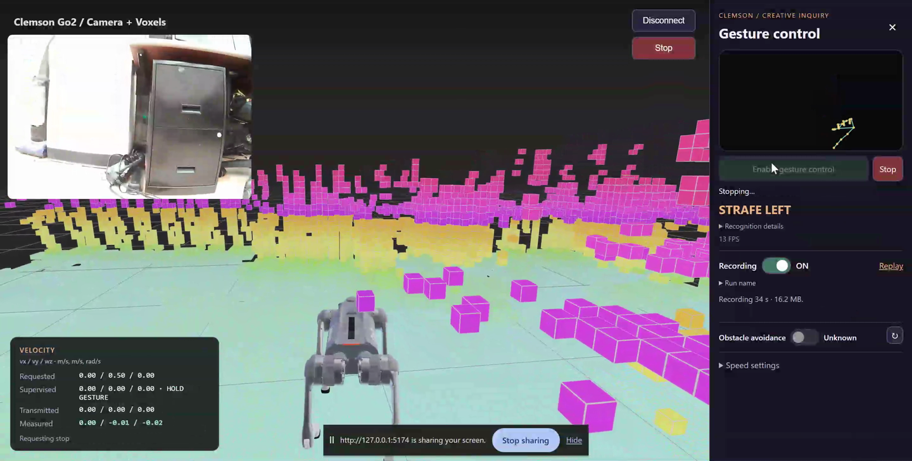
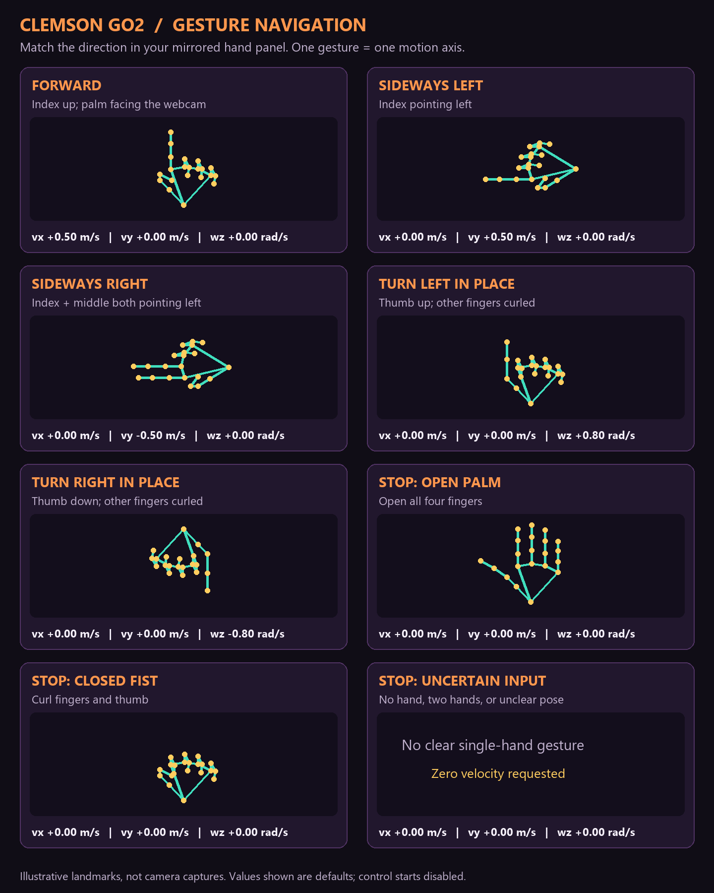

# Your first Go2 gesture-control session

Start with the [course website](https://dyco-ai.github.io/go1_gesture_tracking/),
complete the [simulation labs](https://github.com/sriram-2502/go1-mujoco-playground),
then follow [Go2 hardware onboarding](https://github.com/sriram-2502/go1-mujoco-playground/blob/main/course/GO2_HARDWARE.md).
This page shows what to recognize on screen; the hardware guide has the terminal commands.

## Two cameras, two jobs

- **Windows webcam:** observes your hand. The Clemson panel displays extracted skeletons and labels, not the full webcam image.
- **Go2 camera:** observes the maze. Navigate from this robot view; the instructor retains direct sight and the paired remote.

*Project dashboard capture from the October 30, 2026 recording. The main view
builds on [Unitree UI](https://github.com/legion1581/unitree_ui), with its
[MIT notice](../dashboard/UPSTREAM_LICENSE) retained. See the
[eight-second demo and export details](DEMO.md).*

This capture predates the battery and behavior-button additions; use the table
below for the current layout.

## What to look for in the Clemson edition

| Item | Expected observation |
| --- | --- |
| Robot camera | An updating image of the robot's surroundings, not the Windows webcam or a frozen frame |
| Voxel view | Available robot LiDAR data around the model; voxels alone do not demonstrate full SLAM/navigation readiness |
| Hand panel | One extracted skeleton following your hand and a matching gesture label; use preview before enabling robot control |
| Recognition details | For the instructor classifier, finger/direction/palm hints help explain an `UNKNOWN` pose |
| Velocity overlay | Requested, supervised, transmitted, and measured velocities have separate meanings; sending a command does not prove movement |
| Enable / Stop | Gesture control begins disabled. Click Enable directly, without a startup hand pose; Stop is there and below Disconnect |
| Robot battery | Graphic and numeric percentage below the top-right Stop; unavailable/stale data is labeled, never assumed to be zero |
| Jump once / Bound gait | Buttons below battery; these pause navigation on selection and have separate recovery checks |
| UI build ID | Navigation title includes the same ID printed by the PowerShell launcher; use it to identify stale UI code |
| Recording / avoidance | One overall recording toggle; record the actual avoidance state used for each trial |

You can preview hand recognition before connecting the robot. Motion requires
the instructor-approved connection and checkout, followed by explicit enabling.
Stationary Look Around is removed and tracked as a [TODO](ROADMAP.md#optional-application-improvements).

## Default instructor gestures

Match the **mirrored hand panel**, not another person's view of your hand.

| Hand pose | Label | Default `(vx, vy, wz)` |
| --- | --- | --- |
| Index up, other fingers curled, palm toward webcam | `FORWARD` | `(+0.5, 0, 0)` |
| Index pointing left | `STRAFE_LEFT` | `(0, +0.5, 0)` |
| Index + middle pointing left | `STRAFE_RIGHT` | `(0, -0.5, 0)` |
| Thumb up, other fingers curled | `TURN_LEFT` | `(0, 0, +0.8)` |
| Thumb down, other fingers curled | `TURN_RIGHT` | `(0, 0, -0.8)` |
| Open palm or closed fist | `STOP` | `(0, 0, 0)` |
| Missing hand, two hands, or uncertain pose | `NO_HAND` / `UNKNOWN` | `(0, 0, 0)` |

Units are **m/s, m/s, rad/s**, in the robot's body frame: forward, left, and
counterclockwise yaw. Forward magnitude is adjustable from 0.5–1.0 m/s; turn
magnitude from 0.5–1.0 rad/s; sideways magnitude is fixed at 0.5 m/s.
A movement pose needs 300 ms of consistent fresh observations, and input expires
after 400 ms. Holding a movement pose requests continued motion, not a fixed step.
The illustration shows programmed poses, not measured recognition accuracy.

Earlier simulation `LEFT`/`RIGHT` labels mean turning; they are not these sideways
gestures. If you bring a custom classifier, agree on and report your own table
using [the integration guide](STUDENT_INTEGRATION.md). Do not assume the default
picture still describes your custom classifier.

## Common messages and what to do

| Observation | What to check before enabling again |
| --- | --- |
| Webcam unavailable / starting repeatedly | Activate `go2wifi`, start the Python preview service, check Windows camera permissions, and close other programs using the webcam |
| `UNKNOWN` instead of forward | Show one whole hand; index straight up, others curled, palm toward the webcam; read Recognition details and adjust lighting/distance |
| `HOLD GESTURE` | Keep one clear pose steady; the hold is based on new frames, not repeated copies of a frozen image |
| Zero transmitted velocity despite a requested value | Control may still be disabled or a supervision gate may be active; read its reason rather than changing speed to force motion |
| Browser lost focus / gesture input expired | Return to the dashboard and check fresh input. Re-enable explicitly only after resolving the cause |
| Stop / landing not confirmed | Restore normal standing with the paired remote and visually check all four feet before using the explicit remote-recovery acknowledgement |
| `5051` connection refused in Clemson | Restart the UI through the launcher and reload the tab; Clemson does not need the optional Bluetooth server |
| MediaPipe feedback-tensor / projection warnings in Anaconda | These originate in hand inference, not robot-mode control. Check live FPS, frame age, skeletons, and recognition hints; a Python traceback or unavailable service needs separate diagnosis |
| Robot feedback expired / missing or stale camera | Stop the trial and restore the connection/live streams with the instructor; do not bypass the checks |
| Software Stop is unconfirmed | Follow the instructor's paired-remote intervention procedure and visually check the robot before another trial |

## Before the session and before submitting

1. Install/update while internet is available; record the instructor-approved Git commit.
2. Ask the instructor for the private AES key and Wi-Fi password. Connect through the assigned **Go2 hotspot**, default IP **192.168.12.1**, rather than Clemson campus Wi-Fi.
3. Complete the simulation checkpoint, stationary hardware checks, and gesture preview before instructor-approved movement. Use one robot client at a time.
4. Record run IDs, settings, gesture mapping, avoidance state, results, and interventions. Keep full run ZIPs/videos/telemetry local with a backup.
5. Submit `course/student-work/<team>/<first-last>/week-XX/README.md` on the assigned team branch. Small optional media follows the [submission policy](https://github.com/sriram-2502/go1-mujoco-playground/blob/main/course/SUBMISSIONS.md); no keys or raw run data go to Git.

Offline tests and screenshots are not hardware qualification. A new student's
complete walkthrough and supervised recognition, motion/stop, and recording checks
on the assigned Go2 remain part of the instructor's pre-class readiness review.
