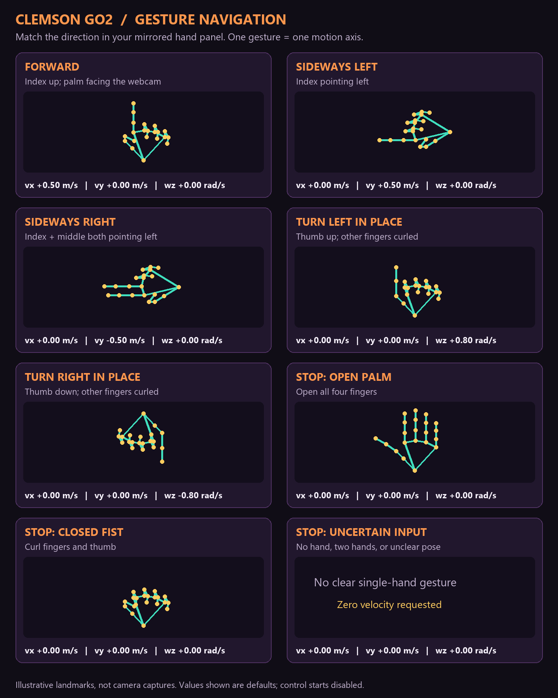

# Clemson Go2 UI

New to the hardware session? Start with the [student visual orientation](../STUDENT_ORIENTATION.md)
for the camera/voxel reference, default hand poses, expected velocities, and common messages.

This is the lab extension path for Creative Inquiry and undergraduate projects.
Use the [Basic edition first](../UI_SETUP.md), then launch the Clemson edition:

```powershell
powershell.exe -NoProfile -ExecutionPolicy Bypass -File .\webrtc\start-ui.ps1 -Edition clemson
```

Open <http://127.0.0.1:5174/>. Run the command from the repository root, after
`setup-ui.ps1 -Edition all` completes. Only one dashboard or Python script should
connect to the robot at a time.

## Gesture guide: what your hand commands

Match the direction shown in the **mirrored hand panel**. The diagrams use the
same 21-landmark skeleton style as the MediaPipe display. They are illustrations,
not recorded recognition results. Test your poses in preview before enabling control.



| Hand gesture | Robot movement | `vx` (m/s) | `vy` (m/s) | `wz` (rad/s) |
| --- | --- | ---: | ---: | ---: |
| Index up, palm facing the webcam | Forward | +0.5 | 0 | 0 |
| Index pointing left | Sideways left | 0 | +0.5 | 0 |
| Index and middle fingers both pointing left | Sideways right | 0 | -0.5 | 0 |
| Thumb up, other fingers curled | Turn left in place | 0 | 0 | +0.8 |
| Thumb down, other fingers curled | Turn right in place | 0 | 0 | -0.8 |
| Open palm or closed fist | Stop | 0 | 0 | 0 |
| No hand, two hands, or an unclear pose | Stop request | 0 | 0 | 0 |

The image and table show **default speeds**. Forward speed can be set from
**0.5 to 1.0 m/s**; turn-speed magnitude from **0.5 to 1.0 rad/s**, default **0.8**.
Sideways speed is fixed at **±0.5 m/s**. Inactive axes always use zero; one gesture
commands one axis. Apply speed changes with **Apply speeds**, then explicitly
re-enable control.

Directions are relative to the **robot**, not the person: positive `vx` is forward,
positive `vy` is the robot's left, and positive `wz` turns counterclockwise viewed
from above. Both sideways gestures point left in the hand panel; the number of
extended fingers chooses the robot's sideways direction.

Hold a movement gesture steadily for **300 ms**. Changing gestures requests zero
while the new gesture stabilizes. Stop, missing hands, and uncertain poses bypass
the movement hold; input older than **400 ms** is rejected. A zero/stop request
does not prove the robot has physically stopped—check feedback and the robot.

Read the [student walkthrough](../gesture_preview/README.md) for examples and
supervised operating steps. The [SVG guide](assets/gesture-guide.svg) is available
for resizing or printing. To regenerate both images after changing a gesture:

```bat
conda activate go2wifi
python -m webrtc.clemson.assets.generate_gesture_guide
```

## If FORWARD shows UNKNOWN

Show **one hand** with the **index pointing straight up on the hand panel**,
**middle/ring/little fingers curled**, and **palm toward the webcam**. Keep your
wrist visible. Point upward, not directly into the camera. Hold the pose for
at least **0.3 seconds**. The default request is `vx=+0.5 m/s`, `vy=0`, `wz=0`.

Check the yellow recognition hint beneath the label. **Recognition details**
shows which fingers are counted as extended, the index direction, and whether
palm facing is confirmed. For example, “Index is up. Turn your palm…” means
finger direction passed but the palm-orientation check did not. Test this with
gesture control disabled before attempting motion. FORWARD recognition and
Enable gesture control are separate: preview recognition alone does not move
the robot.

Pointing direction is measured in the mirrored screen's x/y plane; fingertip
depth does not disqualify an otherwise upward direction. Palm orientation is
checked separately. If the webcam service was running during an update, restart
it and refresh the UI to load the new rules. Tracking starts automatically when
the hand panel opens; robot gesture control still needs explicit enabling.

If tracking stops after a service idle timeout, the panel automatically starts it
again. Failed starts display the actual error and retry after five seconds rather
than leaving “Webcam off” indefinitely. Close other webcam applications if the
device is busy. A different webcam can be selected when launching the service:
`python -m webrtc.gesture_preview.server --camera 1`.

## Available now

- **Go2 battery percentage and graphic** directly below Stop in the top-right
  camera/voxel controls, including when the hand panel is hidden. It uses the
  existing WebRTC lowstate stream and refreshes with
  the 10 Hz status display. Missing, invalid, disconnected, or more than five
  seconds old readings show **Battery unavailable / —%**; a valid zero shows **0%**.
  This is telemetry only, not an automatic battery cutoff or a laptop/remote
  battery reading. Verify the live value against the assigned robot before lab use.
- **Jump once**, **Bound gait**, and **Stationary look around** buttons below the
  battery. Look-around reuses hand gestures: forward sets pitch, sideways sets
  roll, and turn gestures set body yaw. Stop, unknown, missing, or stale hand
  input centers the pose. The scene displays requested roll/pitch/yaw in radians.
  These use the shared robot connection and pause gesture navigation when selected.
  A failed stop reports its recovery stage and provides an explicit remote-recovery
  acknowledgement; it never silently re-enables motion. See [recovery instructions](CONTROL_EXTENSIONS.md#stop-and-recovery).
- Clemson does not use the optional Bluetooth server on port **5051**. The
  [local services guide](CONTROL_EXTENSIONS.md#local-services-and-port-5051)
  explains stale-server Bluetooth proxy errors and the restart procedure.
- **Direct gesture enabling:** click Enable gesture control without a palm/fist
  startup pose. Fresh perception and robot/video feedback are still required;
  a preheld gesture cannot move the robot until new post-enable frames arrive.
- A small **Gesture pose | UI build ID** below the camera-view title confirms
  which UI code is loaded. Startup prints the same build ID; if it differs, close
  the old tab and reopen the displayed local URL after restarting the UI server.
- Separate generated source copy based on the pinned upstream revision.
- One IP/AES connection form, defaulting to **`192.168.12.1`** (Go2 Wi-Fi hotspot).
  The IP is editable. Enter the key and click **Connect and open web view**.
- Successful validation opens the upstream Go2 camera/voxel view directly.
  No landing menu, robot-family picker, account, Bluetooth, mapping, action, or
  service menus are exposed. Disconnect and upstream Stop remain available.
- A compact side panel with extracted MediaPipe hands and Enable/Stop immediately
  below the hand view. Tracking starts automatically; there are no camera-index
  or webcam Start/Stop controls. Speed and recognition details are collapsed.
- A velocity overlay on the main camera/voxel view, showing requested, supervised,
  transmitted, and measured velocities plus stopping results.
- A local Python preview service running in `go2wifi`, reusing the Go1 perception
  scaffold and model without MuJoCo or Qt.
- Student-readable gesture classifier, velocity table, supervisor, and command-line
  examples: start with the [gesture navigation walkthrough](../gesture_preview/README.md).
- Explicitly enabled gesture navigation through the shared WebRTC connection,
  with forward/turn speed settings, fixed ±0.5 m/s lateral motion, feedback checks,
  and guarded stopping. Starts disabled; the existing Go2 setup has been hardware-validated, as confirmed by the maintainer.
- An **Obstacle avoidance** ON/OFF switch with robot state readback.
- One overall **Recording ON/OFF** switch, dashboard and available Go2 video, structured logs,
  and a separate offline replay page. See [recording and replay](../RECORDING.md).

### Record and replay

Use the **Recording** switch in the hand panel. Turn it **ON**, choose the Clemson
tab in Chrome, then enable gesture control separately when ready. Turn **Recording OFF**
to stop and download the video and data together in one ZIP. **Replay** loads that ZIP
without connecting to the robot. Try the synthetic demo at
<http://127.0.0.1:5174/replay.html> before recording a real run.

Replay supports video, seeking, playback speed, extracted hands, telemetry, and
interactive recorded voxels when available. MP4 is preferred; WebM fallback and
local MP4 conversion are supported. See the [guide](../RECORDING.md) for limits,
timestamp alignment, and the short manual Chrome check still required.

### Obstacle avoidance switch

After connecting, the panel reads the robot's current avoidance setting. The
switch displays **ON**, **OFF**, **Pending**, or **Unknown**; it does not assume
an initial value or change avoidance automatically. **Refresh state** reads the
setting again. It is separate from LiDAR/voxel visualization.

Changing the switch disables gesture control and, if moving, completes the guarded
stop sequence before sending the setting. If stopping cannot be confirmed, the
change is cancelled. Re-enable gesture control explicitly afterward. **OFF disables
the robot's obstacle-avoidance behavior.**

The adapter uses the same upstream API: `rt/api/obstacles_avoid/request`, set
`1001` with `{"enable": true/false}`, then get `1002` to confirm the actual value.
Rejected requests and mismatched readback are shown instead of claiming success.
Confirm the state reported by the assigned robot; ON is not a guarantee that
every obstacle will be detected or avoided.

Follow [dependencies and startup](../DEPENDENCIES.md) to run the service and UI.
Hand tracking starts automatically when the panel opens. Hiding the panel stops
tracking and releases the webcam. Test the panel without a robot first.
Only normalized landmark coordinates and gesture metadata leave the Python worker;
the full webcam image is not sent to or displayed in the browser.

The tracked `overlay/` files and [setup script](../setup-ui.ps1) define these changes.
The generated `unitree_ui/` directory is ignored to avoid vendoring another Git
repository and accidentally staging generated files. Preserve edits there before
recreating it. A separately published lab fork can replace this mechanism later.

## Creative Inquiry integration plan

All processing runs locally on Windows 11. Students gesture toward the **Windows
webcam** and steer using the **Go2 camera view**, without seeing the robot directly.
An instructor keeps direct sight of the robot and the paired remote.

1. **Verify the baseline:** camera, telemetry, voxels; use Basic for onboard mapping/localization,
   then short supervised motion and stopping. Do not assume the upstream joystick
   has the same limits or stop sequence as our standalone velocity script.
2. **Shared command interface:** one local service receives student requests and
   forwards them through the browser's existing WebRTC connection. Every motion
   source must pass through one supervisor; manual and student control are exclusive.
3. **MediaPipe preview:** Python owns the webcam and publishes frame IDs, extracted
   landmarks, gesture labels, and proposed/supervised velocities. These geometric
   rules do not provide classifier confidence scores. Control starts disabled.
4. **Gesture control:** instructor enable, command expiry, fresh tracking/state
   checks, camera-staleness stopping, explicit re-enable after reconnection, and
   a validated classroom speed profile. Never repeat an old gesture indefinitely.
5. **Recording:** CSVs for gestures, commands, feedback, and events; metadata JSON;
   optional robot and webcam video with timestamp indexes. Label absent streams
   and dropped samples; alignment is approximate until measured.
6. **Maze layout:** large Go2 camera plus webcam/landmark panel; gesture and
   requested/transmitted/measured velocity; timer and recording status. Instructor
   view includes telemetry and maps. Student view can toggle camera-only versus
   map-assisted navigation according to the activity.

The gesture-to-robot adapter is implemented and tested with simulated transport;
recognition with the operator and physical motion/stopping still need verification.
Recording and offline replay are implemented with offline tests; the browser
capture chooser and live recording performance still need hands-on verification.
Maze scoring is **not implemented yet**.
Keep gait selection, stair mode, and custom
SLAM development outside the first classroom integration.

See [camera-view controls and upstream gait findings](CONTROL_EXTENSIONS.md)
for behavior selection, stopping, and firmware-dependent limitations. These new
behavior controls have offline transport tests; physical behavior needs separate
verification on the assigned Go2.

## Credentials

Students obtain the AES key from the lab's private resource. It is never embedded
in the public UI bundle. Clemson holds the key in page memory and clears it on
disconnect/reload; it does not use the upstream persistent AES cache or raw-key
debug messages. A failed key returns an error on the same form for retry.
Basic retains upstream credential behavior. Previously saved browser data is not
automatically erased by updating source; clear old site data on shared PCs.

## Course and instructor reference status

This [GitHub setup repository](https://github.com/sriram-2502/go2-gesture-nav) is the current CI hardware
reference. Students clone it separately from the playground. A later repository
split remains optional future work; no laptop-local bundle is required.

- [Course website](https://dyco-ai.github.io/go1_gesture_tracking/): schedule and assignment expectations; the course retains its Go1 name.
- [Student code and weekly labs](https://github.com/sriram-2502/go1-mujoco-playground): Go1 simulation followed by Go2 hardware onboarding.
- [Submission/data policy](https://github.com/sriram-2502/go1-mujoco-playground/blob/main/course/SUBMISSIONS.md): individual weekly README reports on team branches, optional small media, full data stored locally, and a final Markdown report.

This hardware version uses Go2 WebRTC on Windows 11. Physical Go1 integration is
under development. Ask the instructor for the AES key and Wi-Fi credentials;
never place them in reports or Git. Install dependencies using internet first,
then join the assigned **Go2 hotspot** at **192.168.12.1** for robot access.
Do not use Clemson campus Wi-Fi for this connection; firewall/client isolation
can interfere. Do not disable security controls to work around connection issues.

Full run ZIPs, telemetry, and videos belong in local experiment storage with a
backup. Export only selected small, sanitized evidence into student submissions.

For a fresh student checkout or instructor updates, follow the [clone and update instructions](../../README.md#clone-this-setup-from-github).

## Bring your course classifier

You can reuse your recognition functions from earlier weeks. See the
[student integration guide](../STUDENT_INTEGRATION.md) for the actual Python
integration point, explicit label mapping, and preview-first checkout. Keep the
instructor supervision and robot connection components.
